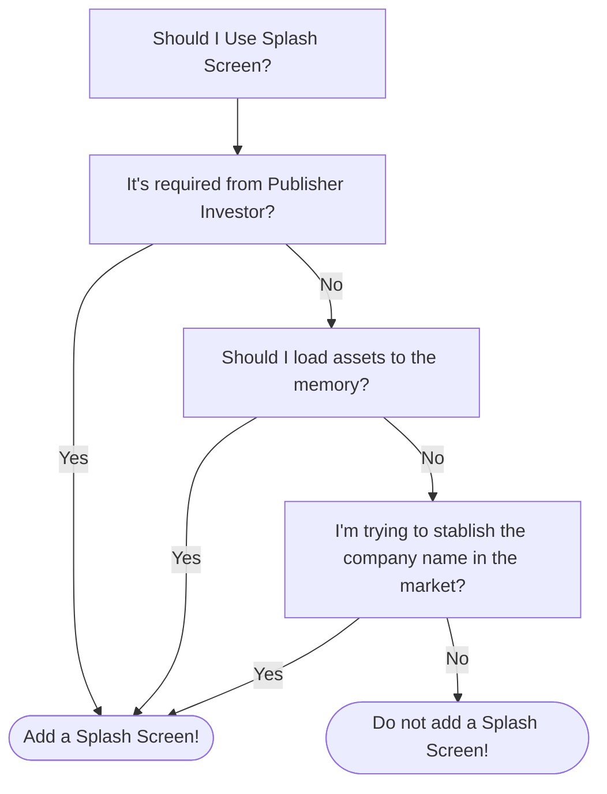

# Should I Use Splash Screens?

In game development, we tend to repeat some formulas and already stablished patterns like game states, scenes and mechanics. We actually don't think too much about it, like Credits screen and Main Menu, every game has it.

What I like to talk today is the importance (or non importance) of Splash Screens. To make it clear, let's define it.

A Splash Screen:

1. Is the first thing that appears when you open the game
2. Can or cannot be skipped
3. Usually is a carousel of Logos (Like the developer logo or Engine) and/or a movie preview of the game.
4. It's NOT part of the gameplay
5. Usually appears before the Main Menu

If you play games, the Splash Screen is very clear on it's appearence. So, why should we use it?

## Two Credits?

If you abstract the idea of a Splash Screen, it's only a shorter Credits screen, for logos and showing which tools the developer has used.

Thinking as: A Credits Screen for the start of the game, A Credits Screen for the end of the game. This shows that we are using two credits screen in a game, why should we use it, then?

Isn't it redundant?

## Expectations and Emotions

There's an expectation of the game, as a medium, from the developer that appears in the splash screen. Imagine you boot a game, the logo that appears is "FromSoftware", this creates an expectation that the game is similar to Demon Souls, Dark Souls or Armored Core.

I'm using a AAA example, but this also applies with indie games like "Aggro Crab" or "Supergiant Games"

This also applies with the End Credits, just after you finish the game, where the catharsis make an emotional impact.

So, consider this as a showcase before the art of the game starts. This can be powerful if you are making a ambitious game (I didn't say Big Game, you can make a small game, but still ambitious).

## Knowing the Unknown

If you are not known in the game market or if your tools/engine is too niche, it's good practice to show this at the splash screen, where the player look and say "Ok... this tool was used/this is the developer then...", and the follow up is the gameplay that make it's memorable.

Imagine I say to you that a game was made in Godot engine. Not much to say, right? But the game in question is "Slay the Spire 2", one of the best indie games ever.

Using this sequence, the tool and developer will be remembered.

## Loading Delay

If you need to load some assets, from disk or network, the Splash Screen can be a smoke and mirrors technique, instead of having a black screen while the assets loads into the memory.

Let's say you need to load some big textures, It's not negotiable, it needs to be loaded before gameplay. Making a 5 to 10 seconds of Splash Screen (better yet, using multithreading) can be very helpful.

## Requirements from Publisher/Investor

Sometimes the Splash Screen is non negotiable, sometimes is a requirement from those who put money into the project, usually from an Investor or a Publisher.

This is an opportunity to check the requirements and add your logo there as well. The player must wait for the sponsored images, so why they shouldn't wait for your content/logo/tools as well?

## So... I should use it?

Maybe.

What I offer you is an option to not use it, or not use it at the start of development. And add it only when it's necessary. This can speed the initial development and makes it faster for the players to just start the game, go directly to the action.

Also, the company name and logo could be in the Main Menu, making it easier to insert into the game and it's more accessible. You could also add a selectable link to the store page, or something similar.

I'll make a graph showing 'when' you should use a Splash Screen:

Even after all that, you (probably) will use a Splash Screen. But, as I've said, you should wait and skip in the initial development phase.

