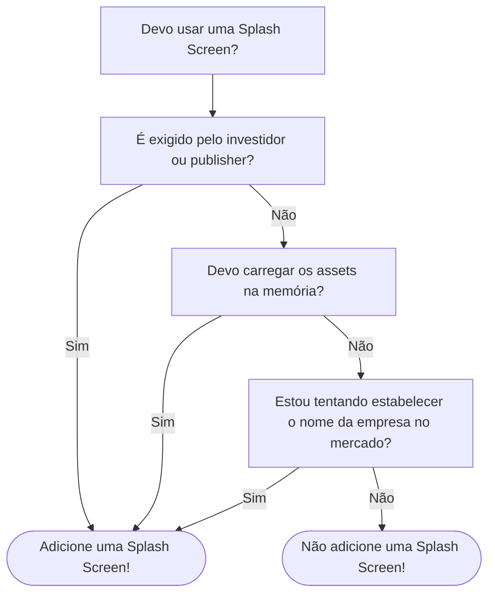

# Eu deveria usar Splash Screens?

No desenvolvimento de jogos, tendemos a repetir algumas fórmulas e padrões já estabelecidos, como game states, cenas e mecânicas. Na verdade, não pensamos muito nisso. Por exemplo, a tela de créditos e o menu principal que estão presentes em todos os jogos.

O que eu gostaria de discutir hoje é a importância (ou a falta dela) das Splash Screens. Para deixar claro do que estamos falando, vamos defini-las.

A Splash Screen:

1. É a primeira coisa que aparece quando você abre um jogo.
2. Pode ou não ser pulado pelo jogador
3. Geralmente é um carrossel de logos (como o logo do desenvolvedor ou da engine) e/ou uma prévia em vídeo da gameplay.
4. Não faz parte da gameplay.
5. Geralmente aparece antes do Menu Principal.

Se você já jogou algum jogo digital, a Splash Screen é bem óbvia em sua aparência. Então nos perguntamos, por que deveríamos usá-la?

## Dois Créditos?

Se abstrairmos a ideia de uma Splash Screen, trata-se apenas de uma versão mais curta da tela de Créditos, para exibir logos e mostrar quais ferramentas o desenvolvedor utilizou.

Pensando da seguinte forma: uma tela de créditos para o início do jogo e uma tela de créditos para o final do jogo. Isso mostra que estamos usando duas telas de créditos em um jogo, mas por que deveríamos usá-las, então?

Não é redundante?

## Expectativas e Emoções

Existe uma expectativa em relação ao jogo, como mídia, que surge do logo da desenvolvedora na Splash Screen. Imagine que você inicia um jogo e o logo que aparece é "FromSoftware". Isso cria a expectativa de que o jogo seja semelhante a Demon Souls, Dark Souls ou Armored Core.

Estou usando um exemplo de um jogo AAA, mas isso também se aplica a jogos indies como da "Aggro Crab" ou "Supergiant Games".

Isso também se aplica aos créditos finais, logo após o término do jogo, onde a catarse gera um impacto emocional.

Então, considere isso como uma apresentação do autor antes que o jogo, como arte, comece. Isso pode ser muito útil se você estiver criando um jogo ambicioso (não disse "jogo grande", você pode fazer um jogo pequeno, mas ainda assim ambicioso).

## Conhecendo o Desconhecido

Se você não é conhecido no mercado de jogos ou se suas ferramentas/engine são muito específicos, é uma boa prática mostrar isso na tela inicial, onde o jogador olha e pensa "Ok... esta ferramenta foi usada/este é o desenvolvedor...", e o que vem a seguir é a jogabilidade que a torna memorável.

Imagine que eu lhe diga que um jogo foi feito na Godot Engine. Não é grande coisa, certo? Mas o jogo em questão é "Slay the Spire 2", um dos melhores jogos indie de todos os tempos.

Utilizando essa sequência, a ferramenta e o desenvolvedor serão lembrados.

## Uma Espera no Carregamento Inicial

Se você precisar carregar alguns assets, seja do disco ou da internet, a Splash Screen pode ser uma técnica de "fumaça e espelhos", em vez de exibir uma tela preta enquanto os recursos são carregados na memória.

Digamos que você precise carregar algumas texturas em grande resolução. No exemplo, isso não é negociável, elas precisam ser carregadas antes do jogo. Então, criar uma splash screen de 5 a 10 segundos (melhor ainda se estiver usando multithreading) pode ser muito útil.

## Requisitos da Publisher/Investidor

Às vezes, a Splash Screen é indispensável, às vezes é uma exigência de quem investe dinheiro no projeto, geralmente um investidor ou uma publisher.

Esta é uma oportunidade para verificar os requisitos e adicionar seu logo também. O jogador precisa esperar pelas imagens patrocinadas, então por que não esperar também pelo seu conteúdo/logo/ferramentas?

## Então... eu deveria usar?

Talvez.

O que eu ofereço é a opção de não usar uma Splash Screen, ou de não usá-la no início do desenvolvimento. Adicioná-la somente quando necessário pode acelerar o desenvolvimento inicial e permitir que os jogadores comecem o jogo mais rapidamente, indo direto para a ação.

Além disso, o nome e o logo da empresa poderiam estar no Menu Inicial, facilitando a inserção da sua marca no jogo e tornando-os mais acessíveis. Você também poderia adicionar um link clicável para a página da loja ou algo semelhante.

Vou criar um gráfico mostrando 'quando' você deve usar uma Splash Screen:

Mesmo depois de tudo isso, você (provavelmente) usará uma Splash Screen. Mas, como eu disse, é melhor esperar e pular essa etapa na fase inicial de desenvolvimento.

